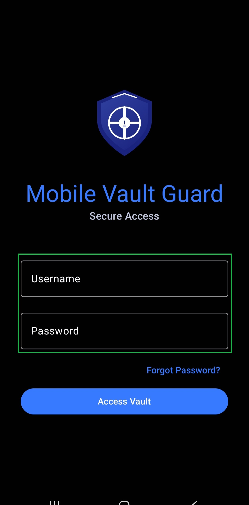
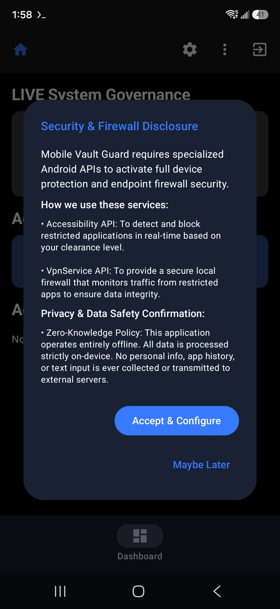
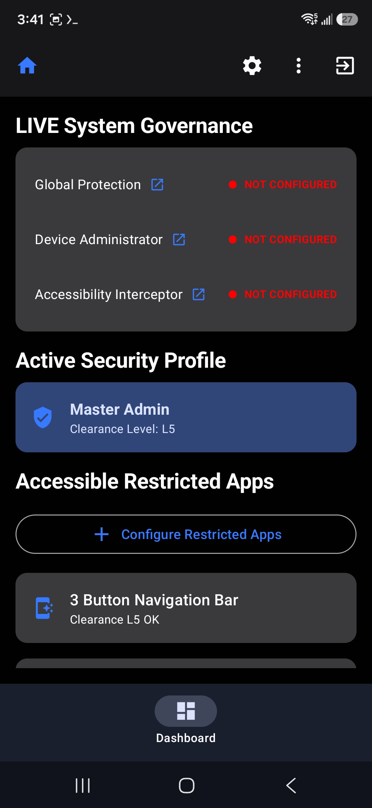
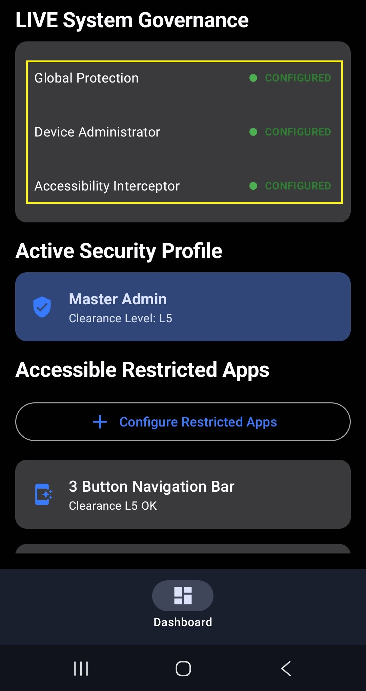

# 🇺🇸 Mobile Vault Guard (MVG) - User Guide

[← Back to Main README](../../README.md)

---

## 🚀 1. Initial Installation & Setup

Because MVG works 100% offline on your phone (Zero-Knowledge), all your data stays private on your device. Follow these easy steps:

1. **Download the App:** Install Mobile Vault Guard directly from the [Google Play Store](https://play.google.com/store/apps/details?id=com.cg.vaultguard).
2. **Set Up Your Master Account:** When you open the app for the first time, create your main Admin account. 
   * *Note: This admin account gets Level 5 clearance, which locks all apps right away to keep your phone safe.*
3. **Fill the Form:** Enter your username, password, and secret recovery question. Keep your answers safe offline.
4. **Log In:** Sign in with your new admin account.

---

## ⚙️ 2. Step-by-Step Configuration

To turn on your security shield, follow these steps right after logging in:

1. **Accept Permissions:** Click **Accept & Configure** when prompted.
2. **Turn on the 3 Main Protections:**
   * **Global Protection:** Press the button to turn it ON (and press again to turn OFF).
   * **Device Administrator:** Press it, then press **Activate**. To turn it off later, press it again and select **Disable**.
   * **Accessibility Interceptor:** Press it, go to **Installed Apps**, select **Mobile Vault Guard**, and turn the switch **ON**. Do the same if you ever need to turn it OFF.
3. **Verify:** Make sure all options are turned on so your phone is fully shielded.

---

## 📸 App Preview

Explore the interface of MVG. All screens visualized below load directly from your local repository assets.

<table>
  <tr>
    <td align="center" width="33%">
       
      <b>Step 1</b> Log in
    </td>
    <td align="center" width="33%">
       
      <b>Step 2</b> Press Accept and Configure
    </td>
    <td align="center" width="33%">
       
      <b>Step 3</b> Dashboard before enabling the configuration
    </td>
  </tr>
  <tr>
    <td align="center">
       
      <b>Step 4a</b> Open Accessibility settings
    </td>
    <td align="center">
       
      <b>Step 4b</b> Select VaultGuard
    </td>
    <td align="center">
       
      <b>Step 4c</b> Turn the service on
    </td>
  </tr>
  <tr>
    <td align="center">
       
      <b>Step 5</b> Activate the administrator configuration
    </td>
    <td align="center">
       
      <b>Step 6</b> Dashboard after enabling the configuration
    </td>
    <td></td>
  </tr>
</table>

---

## 💡 3. Practical Security Use Cases

### 1. Test Default Security
* Sign out of the app.
* Try opening any app on your phone.
* **Result:** The app will be locked, and MVG will ask you to log in with your password or fingerprint.

### 2. Set Up Easy Daily Use (Kid & Family Safe)
* Tap the **3 dots menu** (`...`) in the corner and select **User Management**. Create a new user with a lower level (Level 1 to 4).
* Go back to the **3 dots menu** (`...`), select **Firewall Governance**, and open **App Firewall**.
* Tap the **Plus sign (+)**, find the apps you want to leave open for daily use (like WhatsApp or browser), and turn their toggle switch **OFF** to allow them.
* Sign out of the admin account. Now, unallowed apps will require the user password or admin clearance to open.

### 3. Set Up Auto-Lock
* Go to **Settings** and choose your preferred **Autolock out** time so the app locks automatically when you are not using your phone.

---

## ⚠️ 4. CRITICAL WARNING: Passwords & Secret Questions

* **Remember Your Password:** VaultGuard does not use cloud servers. **TCRIK Media & Security Inc. does not store your password or secret questions.**
* **No Recovery Help:** If you forget both your password and secret questions, **there is nothing we can do to help you recover your account or data**. 
* **Safe Advice:** Write your password down and keep it in a secure physical place (like a safe). Treat it like the physical key to a house vault.

---

## 🛡️ 5. Core Benefits

* **Child Safe:** Let kids use your phone safely by blocking access to sensitive apps.
* **Protect Private Photos:** Keep your personal pictures and documents safe from snooping.
* **Protect Sensitive Apps:** Lock email, social media, banking apps, and crypto wallets.
* **Total Anti-Hack Protection:** Blocks unauthorized entry and stops hackers from breaking into your phone.
* **Travel & Police Security:** Keep your personal data private and secure when traveling or passing through checkpoints.

---

## 🔧 6. How to Restrict or Allow an App

1. Go to the Home dashboard.
2. Tap the **3 dots menu** (`...`).
3. Select **Firewall Governance** -> **App Firewall**.
4. Tap the **+** button and select the app (e.g., WhatsApp). By default, new apps are restricted (ON).
5. **To Allow an App:** Turn the toggle switch **OFF** next to the app. It can now be opened without restrictions.
6. **To Restrict an App:** Tap the app, choose settings, pick a minimum clearance level, and turn restricted access **ON**. Tap **Done** and **Close**.

---

## 👥 7. User Management (Adding New Users)

1. Go to the Home dashboard and tap the **3 dots menu** (`...`).
2. Select **User Management**, then tap the person icon (`+`).
3. Enter a username and a temporary password, and choose their clearance level (L1 to L4). Tap **Create**.
4. Log out of admin, have the new user log in with the temporary password, and ask them to change their password immediately from their settings page.
