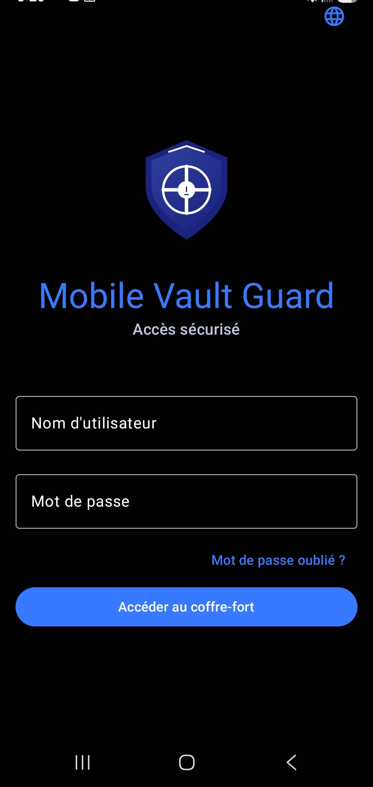
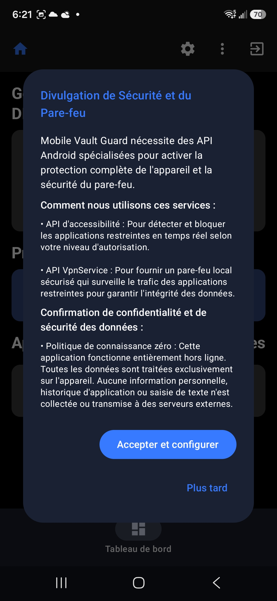
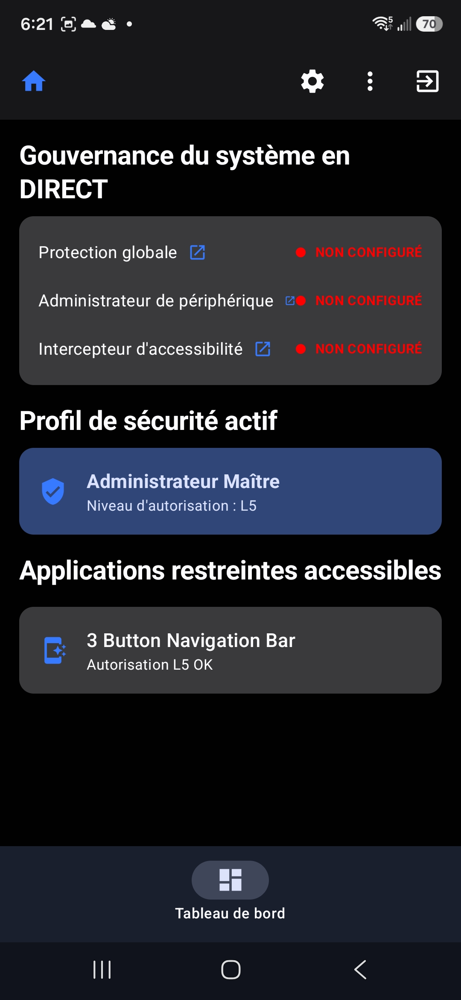
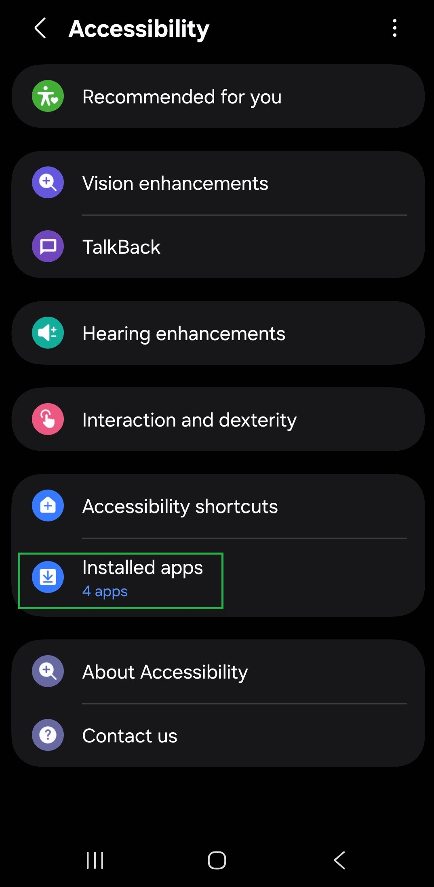
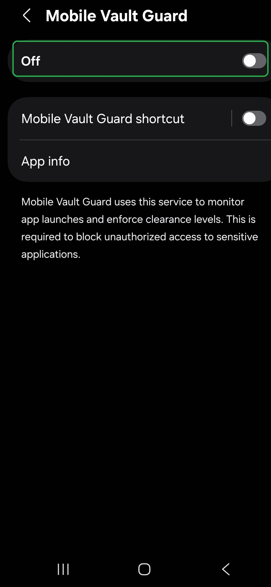
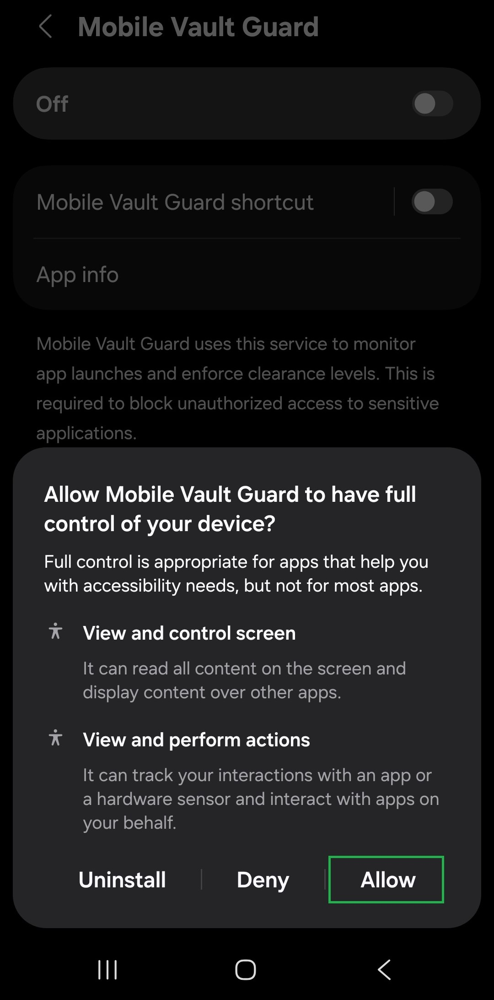
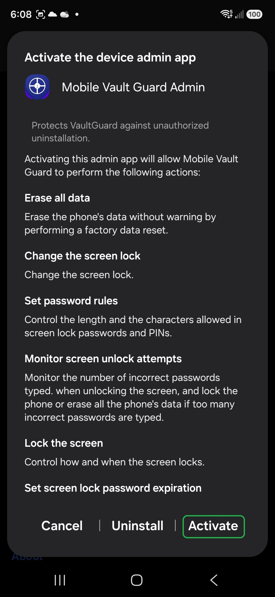
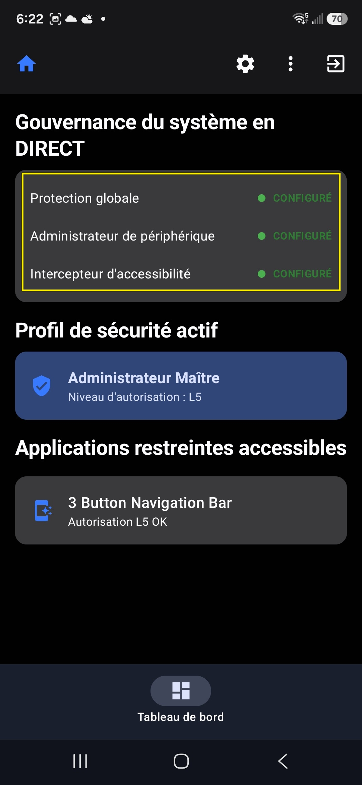

# 🇫🇷 Mobile Vault Guard (MVG) - Guide d'utilisation

[← Retour au README principal](../../README.md)

---

## 🚀 1. Installation initiale et configuration

Parce que MVG fonctionne 100 % hors ligne sur votre téléphone (Zero-Knowledge), toutes vos données restent privées sur votre appareil. Suivez ces étapes simples :

1. **Télécharger l'application :** Installez Mobile Vault Guard directement depuis le [Google Play Store](https://play.google.com/store/apps/details?id=com.cg.vaultguard).
2. **Créer le compte maître :** Lors du premier lancement, créez votre compte administrateur principal. 
   * *Remarque : Ce compte maître obtient le niveau d'habilitation 5, ce qui verrouille immédiatement toutes les applications pour protéger votre téléphone.*
3. **Remplir le formulaire :** Entrez votre nom d'utilisateur, votre mot de passe et votre question secrète de récupération. Conservez ces informations en lieu sûr hors ligne.
4. **Se connecter :** Connectez-vous avec votre nouveau compte administrateur.

---

## ⚙️ 2. Configuration étape par étape

Pour activer votre bouclier de sécurité, suivez ces étapes juste après la connexion :

1. **Accepter les autorisations :** Cliquez sur **Accept & Configure** lorsque l'application le demande.
2. **Activer les 3 protections principales :**
   * **Global Protection :** Appuyez sur le bouton pour l'activer (ON) ou le désactiver (OFF).
   * **Device Administrator :** Appuyez dessus, puis sur **Activer**. Pour le désactiver plus tard, appuyez à nouveau et sélectionnez **Désactiver**.
   * **Accessibility Interceptor :** Appuyez dessus, allez dans **Applications installées**, sélectionnez **Mobile Vault Guard**, et activez l'interrupteur (**ON**). Faites de même si vous devez le désactiver (**OFF**).
3. **Vérification :** Assurez-vous que toutes les options sont activées pour que votre téléphone soit entièrement protégé.

---

## 📸 Aperçu de l'application

Découvrez l'interface de MVG. Les captures d'écran ci-dessous sont chargées directement depuis le dossier de votre dépôt local.

<table>
  <tr>
    <td align="center" width="33%">
       
      <b>Étape 1</b> Se connecter
    </td>
    <td align="center" width="33%">
       
      <b>Étape 2</b> Appuyer sur Accepter et configurer
    </td>
    <td align="center" width="33%">
       
      <b>Étape 3</b> Tableau de bord avant l'activation de la configuration
    </td>
  </tr>
  <tr>
    <td align="center">
       
      <b>Étape 4a</b> Ouvrir les paramètres d'accessibilité
    </td>
    <td align="center">
       
      <b>Étape 4b</b> Sélectionner VaultGuard
    </td>
    <td align="center">
       
      <b>Étape 4c</b> Activer le service
    </td>
  </tr>
  <tr>
    <td align="center">
       
      <b>Étape 5</b> Activer la configuration administrateur
    </td>
    <td align="center">
       
      <b>Étape 6</b> Tableau de bord après l'activation de la configuration
    </td>
    <td></td>
  </tr>
</table>

---

## 💡 3. Exemples d'utilisation pratique

### 1. Tester la sécurité par défaut
* Déconnectez-vous de l'application.
* Essayez d'ouvrir n'importe quelle application sur votre téléphone.
* **Résultat :** L'application est verrouillée et MVG vous demande de vous connecter avec votre mot de passe ou votre empreinte digitale.

### 2. Configurer l'utilisation quotidienne (Sécurité famille / enfants)
* Appuyez sur le **menu des 3 points** (`...`) dans le coin et sélectionnez **User Management**. Créez un nouvel utilisateur avec un niveau plus bas (Niveau 1 à 4).
* Retournez dans le **menu des 3 points** (`...`), sélectionnez **Firewall Governance**, puis **App Firewall**.
* Appuyez sur le bouton **Plus (+)**, trouvez les applications que vous souhaitez laisser ouvertes au quotidien (comme WhatsApp ou un navigateur), et désactivez leur interrupteur (**OFF**) pour les autoriser.
* Déconnectez-vous du compte administrateur. Désormais, les applications non autorisées exigeront le mot de passe ou l'habilitation pour s'ouvrir.

### 3. Configurer le verrouillage automatique (Autolock)
* Allez dans **Settings** et choisissez le délai de verrouillage automatique souhaité pour que l'application se verrouille toute seule lorsque vous n'utilisez pas votre téléphone.

---

## ⚠️ 4. AVERTISSEMENT CRITIQUE : Mots de passe et questions secrètes

* **Mémorisez votre mot de passe :** VaultGuard n'utilise pas de serveurs cloud. **TCRIK Media & Security Inc. ne stocke jamais votre mot de passe ni vos questions secrètes.**
* **Aucune aide pour la récupération :** Si vous oubliez à la fois votre mot de passe et vos questions secrètes, **il n'y a absolument rien que nous puissions faire pour vous aider à récupérer votre compte ou vos données**.
* **Conseil de sécurité :** Notez votre mot de passe sur papier et conservez-le dans un endroit physique sécurisé (comme un coffre-fort). Traitez-le comme la clé physique d'un coffre-fort.

---

## 🛡️ 5. Avantages principaux

* **Sécurité pour les enfants :** Laissez vos enfants utiliser votre téléphone en toute sécurité en bloquant l'accès aux applications sensibles.
* **Protection des photos privées :** Gardez vos photos et documents personnels à l'abri des regards indiscrets.
* **Protection des applications sensibles :** Verrouillez vos e-mails, réseaux sociaux, applications bancaires et portefeuilles crypto.
* **Défense anti-piratage totale :** Bloque les accès non autorisés et empêche les pirates d'entrer dans votre téléphone.
* **Sécurité en voyage :** Protégez vos données personnelles lors de vos déplacements et lors des contrôles.

---

## 🔧 6. Comment restreindre ou autoriser une application

1. Allez sur le tableau de bord d'accueil.
2. Appuyez sur le **menu des 3 points** (`...`).
3. Sélectionnez **Firewall Governance** -> **App Firewall**.
4. Appuyez sur le bouton **+** et sélectionnez l'application (par exemple, WhatsApp). Par défaut, les nouvelles applications sont restreintes (ON).
5. **Pour autoriser une application :** Désactivez l'interrupteur (**OFF**) à côté de l'application. Elle peut désormais être ouverte sans restriction.
6. **Pour restreindre une application :** Appuyez sur l'application, choisissez les paramètres, définissez un niveau d'habilitation minimum, et activez l'accès restreint (**ON**). Appuyez sur **Done** puis **Close**.

---

## 👥 7. Gestion des utilisateurs (Ajout de nouveaux utilisateurs)

1. Allez sur le tableau de bord et appuyez sur le **menu des 3 points** (`...`).
2. Sélectionnez **User Management**, puis appuyez sur l'icône d'ajout d'utilisateur (`+`).
3. Entrez un nom d'utilisateur et un mot de passe temporaire, et choisissez leur niveau d'habilitation (L1 à L4). Appuyez sur **Create**.
4. Déconnectez-vous de la session admin, demandez au nouvel utilisateur de se connecter avec le mot de passe temporaire, et demandez-lui de modifier immédiatement son mot de passe depuis ses paramètres.
